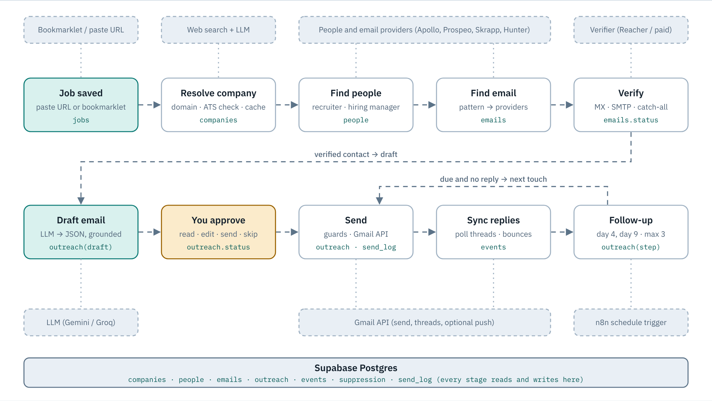
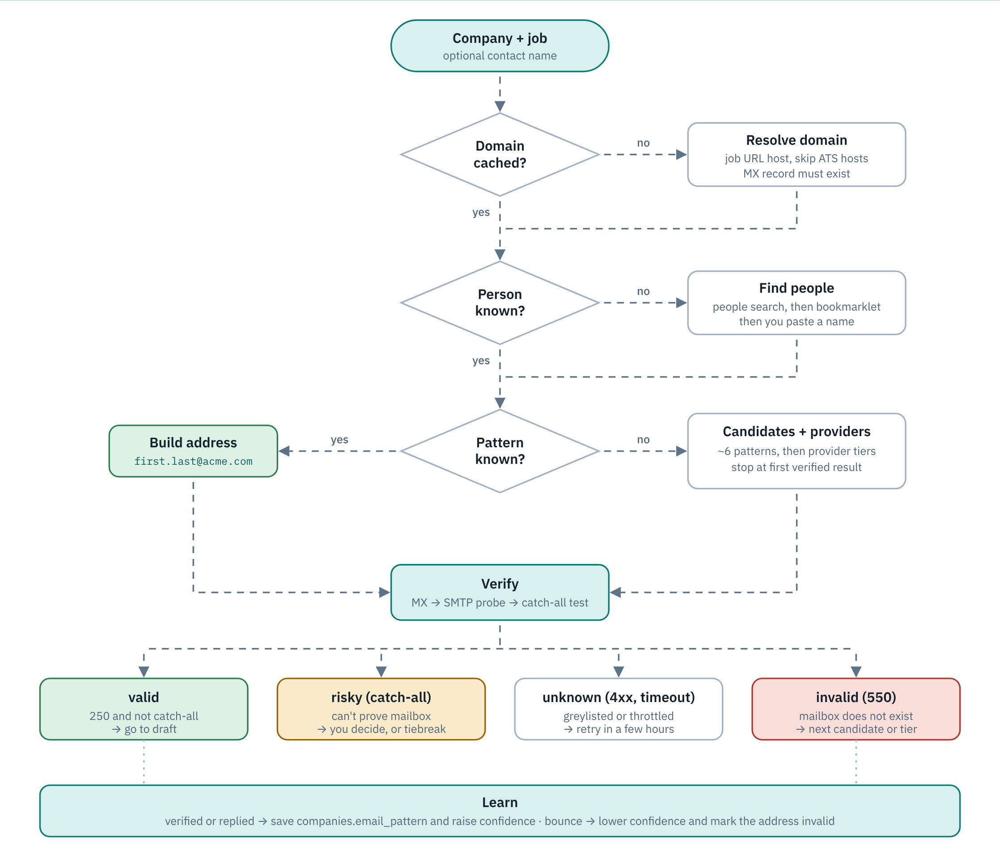
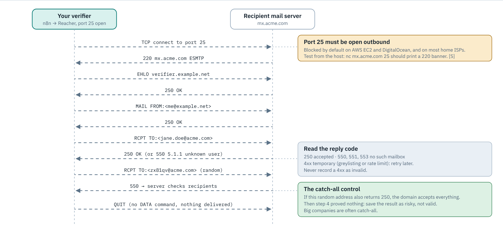
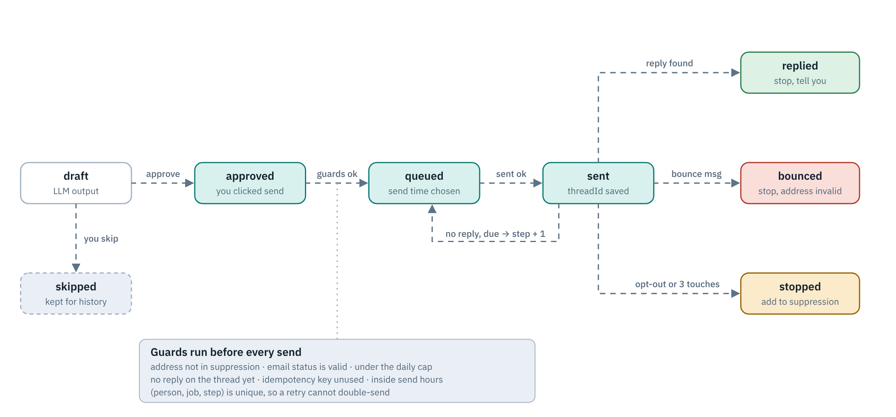
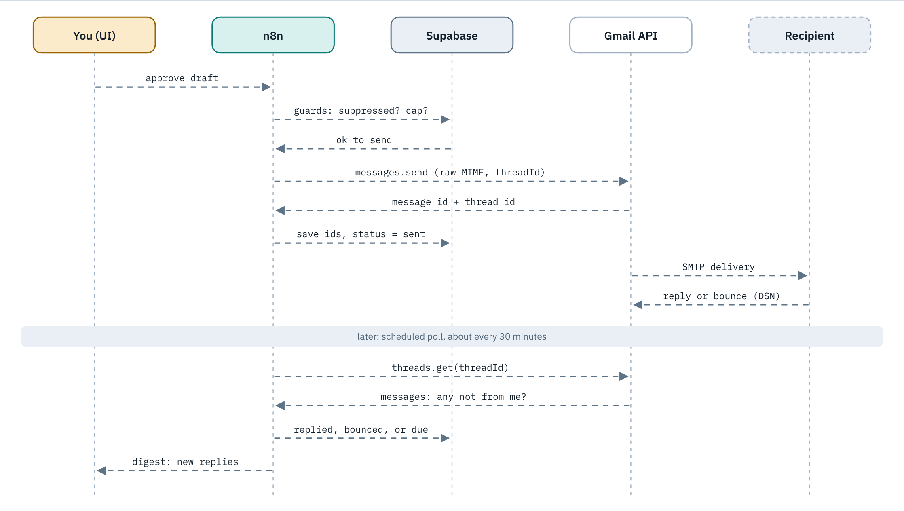
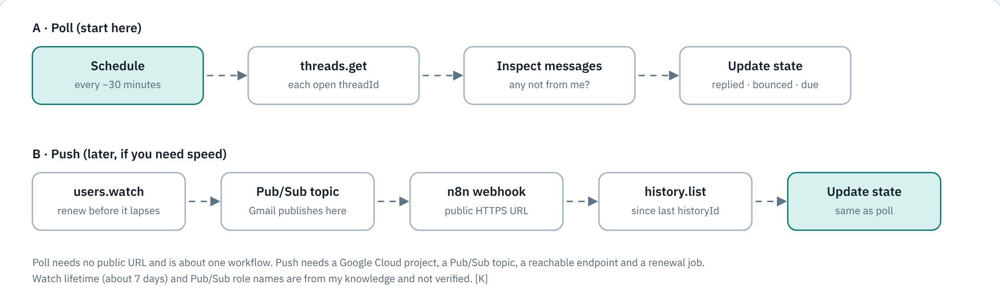
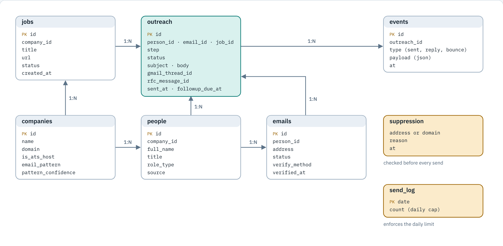
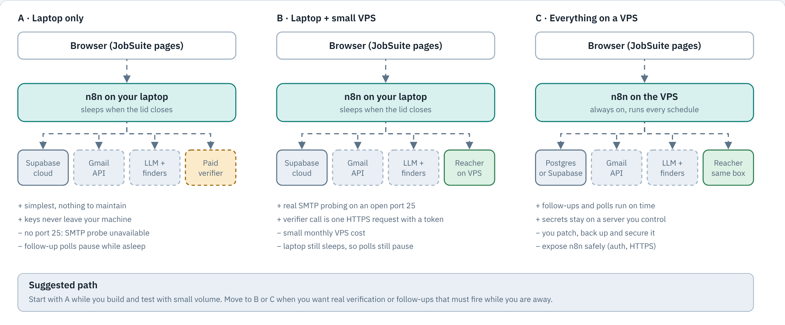

# Personal Outreach System: Architecture Guide

A reference design for building your own recruiter and hiring-manager outreach pipeline for JobSuite, without depending on Hunter.io. It covers finding the person, getting a verified address, writing the email, sending it from your Gmail, and following up until someone replies.

**How to read this file:** read sections 1 to 3 for the big picture and the verdict, then go through sections 4 to 10 in order (each has a diagram). Section 11 is the build order. Section 12 lists what is still unconfirmed.

**Evidence tags used below**

- **[S]** comes from web sources found during research. Most are vendor blogs, so treat numbers as soft.
- **[K]** comes from my own background knowledge and was not verified. Google's own docs were unreachable from the research sandbox.
- Ratings and recommendations are my judgment, not measurements.

An interactive version with step-through animation of the diagrams was published as a private page: https://claude.ai/artifact/PtHciJkse6ZXU7RBLxjBAm

---

## Contents

1. [What exists today](#1-what-exists-today)
2. [The problem in six parts](#2-the-problem-in-six-parts)
3. [Verdict and recommendation](#3-verdict-and-recommendation)
4. [The whole pipeline](#4-the-whole-pipeline)
5. [Finding the contact](#5-finding-the-contact)
6. [Verifying an address without sending](#6-verifying-an-address-without-sending)
7. [Life of one email (state machine)](#7-life-of-one-email-state-machine)
8. [Writing the message (the agent part)](#8-writing-the-message-the-agent-part)
9. [Sending and catching replies](#9-sending-and-catching-replies)
10. [Data model](#10-data-model)
11. [Hosting](#11-hosting)
12. [Comparing the options](#12-comparing-the-options)
13. [Deliverability and legal basics](#13-deliverability-and-legal-basics)
14. [Build order](#14-build-order)
15. [Risk checklist](#15-risk-checklist)
16. [Open questions and sources](#16-open-questions-and-sources)

---

## 1. What exists today

The "mailing agent" in this repo is three loosely connected pieces, not a real agent.

| Piece | Where | What it does |
|---|---|---|
| Email writer | `n8n_workflows/workflow_10_outreach_email_code.js` | Builds a Groq (Llama 3.3 70B) prompt for a cold email or a referral request. Embeds your full resume. Returns plain text. |
| Contact finder | `frontend/outreach-email.html` (`findContact`) and the `find_contacts` tool in `frontend/chatbot.js` | Calls Hunter.io directly from the browser. |
| Delivery | `frontend/outreach-email.html` (Gmail section) | Google OAuth with the `gmail.compose` scope. Saves a draft only. It never sends. |

### Problems found in the current code

1. **The domain is guessed.** `outreach-email.html` builds it as the company name lowercased with spaces removed plus `.com`. "Google LLC" becomes `googlellc.com`, and "Scale AI" becomes `scaleai.com` (the real domain is `scale.com`). Most Hunter misses start here.
2. **Keys sit in the browser.** The Hunter key and the Gmail token are stored in `localStorage`, and the Hunter key goes in the URL query string.
3. **Nothing is saved.** The `contacts` and `outreach_emails` tables exist in `scripts/setup-supabase.sql`, but no page writes to them. The Contacts page uses a different table, `hiring_contacts`.
4. **No send, follow-up or reply detection.** Workflows 20 to 23 (find contacts, save outreach, send outreach) were planned and never built. Apollo was planned and never built.
5. **Email quality bugs.**
   - The prompt asks the model for a signature, and the page then appends a second signature, so it appears twice.
   - The referral prompt says "mention the shared connection" but the form has no connection field, so the model invents one.
   - The subject line is hardcoded in the page, not written by the model.
   - Model output goes into `innerHTML` without escaping.
6. **The plan and the code disagree on Hunter's quota.** The plan says 25 searches a month. Current sources say about 50 credits.

### Why Hunter is the wrong foundation

- The free quota is small.
- Hunter indexes addresses that are public on the web, so it is weakest for individual recruiters at large companies.
- There is no loop. Nothing is cached, no company email pattern is learned, and nothing is fed back from bounces.

---

## 2. The problem in six parts

Outreach is six separate sub-problems. Most cold-email tools are these six glued together.

| # | Sub-problem | Hardest part | Cheapest good answer |
|---|---|---|---|
| 1 | Pick the right person | Finding names of recruiters and hiring managers | People search (Apollo-style) plus your own bookmarklet |
| 2 | Get the address | Wrong domain, unknown naming pattern | Domain resolver, pattern inference, provider fallback |
| 3 | Verify it | Catch-all domains, port 25 blocked | Layered verification where "risky" is a real status |
| 4 | Write the message | Invented claims, template feel | Structured LLM output grounded in your resume |
| 5 | Deliver | Reputation of your one Gmail account | Low volume, verified-only, plain text |
| 6 | Follow through | Reply detection, threading, stopping | Thread polling plus a state machine |

---

## 3. Verdict and recommendation

**Build "manual assist plus hybrid engine."** You pick the person (using your bookmarklet on a page you opened yourself). The system does everything else: domain, email pattern, verification, drafting, sending, and follow-ups. It is the quickest route to something reliable, and a paid provider can be added later as one tier.

**Host it in stages.** Start on your laptop. Move to a small VPS when you want real SMTP verification or follow-ups that fire while your laptop is asleep (section 11).

**Fix the database first.** Pick one jobs table and one contacts table and point every page at them. Everything else depends on that.

---

## 4. The whole pipeline

Ten stages, one database, four outside services. Each stage is one n8n workflow that takes JSON in, writes its result to Supabase, and hands off. A person approves before anything is sent.



**Look for**

- One workflow per stage with a written input and output JSON shape, so you can test and replace a stage alone.
- State written before side effects: save `status=queued`, then send, then save `sent`. A crash in the middle must not cause a second send.
- A human gate before the first send, and a global pause switch.
- Secrets only in n8n credentials. The browser calls webhooks and never holds an API key.

**Common failures**

- One giant workflow nobody can debug.
- Retry logic that re-sends. n8n retries nodes, so every send needs an idempotency key.
- Two sources of truth for contacts.

**Decide early**

- n8n for everything, or a small service for the sending core and n8n for glue.
- Which mailbox sends. Your main Gmail has the best trust and the most to lose.
- Starting volume. 10 to 20 a day is a sensible first ceiling.

---

## 5. Finding the contact

### How email finders actually work

Every finder, Hunter included, mixes three layers [S]:

1. **Pattern generation.** Produce candidates like `first.last@`, `flast@`, `first@`, `firstlast@`.
2. **Source lookup.** Find the address or the pattern from evidence: addresses seen on the public web, a provider's own database, company pages.
3. **Verification.** Confirm the address is deliverable (section 6).

**Pattern inference is the highest-leverage idea.** One confirmed address at a domain (for example `jane.doe@acme.com`) tells you the company uses `first.last`. That then applies to every person there. Store it yourself as `domain → pattern → confidence → evidence count`. [K]

**Waterfall enrichment** (Clay, BetterContact, lemlist) queries providers in sequence and stops at the first acceptable result. Verification runs after each tier. The trade-off is that the first "valid" hit wins, even if it is a shared alias or catch-all inbox nobody reads. [S]

### Decision flow

The walk-through follows the hardest case: new company, no name, no known pattern.



### Five architecture options

| Option | How it works | Fit |
|---|---|---|
| A. Single provider | Form → guess domain → Hunter → email | Fine as one tier, weak as a foundation |
| B. Waterfall of providers | Try several providers in order, verify each | Best hit rate for little engineering, but credits add up |
| C. Pattern plus self-verify | Domain → pattern or candidates → your own SMTP probe | Free and private, but needs a name first and a host with port 25 |
| D. Hybrid | C as the core, B as plug-in tiers | Strong, more build effort |
| E. Manual assist | You pick the person, the system does the rest | Highest accuracy and lowest legal or ToS risk, lower scale |

### Look for

- **ATS host denylist.** A job link on `boards.greenhouse.io`, `jobs.lever.co`, `*.myworkdayjobs.com` or `jobs.ashbyhq.com` gives you the vendor, not the employer. [K]
- **Evidence for each pattern.** One example is a hint, three is a rule.
- **Provider order by cost and quality.** Cheapest reliable tier first, paid credits last, stop at the first verified hit.
- **Role priority.** For a job: the recruiter on that team, then the hiring manager. For a referral: an engineer on the team.

### Patterns to generate

`first.last`, `first`, `flast`, `firstlast`, `first_last`, `f.last`, `firstl`, `last.first`. Strip accents and punctuation, and handle hyphenated and multi-part surnames. Try the two or three most common first. Every extra probe costs reputation and time.

### Common failures

- Brand domain vs corporate mail domain.
- Stale people data (someone changed jobs).
- Mixed patterns after an acquisition. Keep a primary and a secondary pattern.
- Automated LinkedIn scraping. Terms-of-service and account-ban risk, so prefer capturing pages you open yourself. [K]

### People sources to evaluate

Provider people search, company team and careers pages, the recruiter named in the job posting itself, GitHub org members, conference and speaker pages, and your own LinkedIn browsing through the bookmarklet.

---

## 6. Verifying an address without sending

The probe talks to the recipient's mail server, asks whether it would accept the address, then hangs up before any message is sent.



### The ladder (run cheap checks first)

1. Syntax check.
2. Disposable and role detection (flag `info@`, `jobs@`, `hr@`).
3. DNS and MX lookup: does the domain accept mail at all?
4. SMTP probe: `EHLO`, `MAIL FROM`, `RCPT TO:<candidate>`, read the reply, `QUIT`. [S]
5. Catch-all test: `RCPT TO` a random nonsense address on the same domain.
6. Paid tiebreak only for finalists.

### Reading replies

- `250`: server accepts that recipient.
- `550`, `551`, `553`: no such mailbox. [S]
- `4xx`: temporary (greylisting or rate limit). Retry later and never record it as invalid. [K]
- If the nonsense address also gets `250`, the domain is catch-all and SMTP proves nothing. Save the result as **risky**. [S]

### Status model to adopt

Use a taxonomy, not a boolean: `valid`, `invalid`, `risky`, `unknown`, `role`, `disposable`. Store `checked_at`, the method, and the raw SMTP reply. Real send outcomes feed back: a reply proves an address, and a bounce overrides any earlier "valid".

### Where it runs

- It needs outbound **port 25** and an IP that is not on blocklists. Port 25 is blocked by default on AWS EC2 and DigitalOcean, and on most home ISPs. Google Cloud and Azure sources disagree. Hetzner and OVH are reported more open, but Hetzner may block new servers for 24 to 48 hours. Test with `nc <mx-host> 25`: a `220` banner means open. [S]
- **Reacher** (`reacherhq/backend`, Docker) already implements syntax, MX, SMTP and catch-all checks. It is AGPL-3.0 with a paid commercial option. [S]
- Lighter option: a paid verifier called only for finalists, so cost stays near zero.

### Known blind spots

- Catch-all domains (common at large companies).
- Microsoft 365 tenants behave differently and sources conflict. I found no first-party statement. [S]
- Yahoo, AOL and parts of Microsoft harden against probing. [S]
- Probing from a new or blocklisted IP gives false negatives.
- Probes that arrive too fast get throttled, so pace them. [S]

### Open-source verifiers to read

| Project | Notes |
|---|---|
| Reacher / check-if-email-exists (Rust) | Most complete. AGPL-3.0 with a commercial option. [S] |
| Truemail (Ruby, MIT) | SMTP plus disposable checks. [S] |
| `email-verifier` (Go, MIT) | Syntax and DNS only, per one comparison. [S] |
| Deep Email Validator (JS, MIT) | Mentioned in comparisons. [S] |

---

## 7. Life of one email (state machine)

Every outreach row moves through a small state machine. Writing it down first prevents the two worst bugs: sending twice, and following up after a reply.



### Guards that run before every send

- Address not in the suppression list.
- Email status is `valid`.
- Under the daily cap.
- No reply on the thread yet.
- Idempotency key unused: `(person, job, step)` is unique, so a retry cannot double-send.
- Inside send hours.

### Policies to write down

- Touch schedule (for example day 0, day 4, day 9) and a hard cap of three.
- Send window: the recipient's local business hours, with random jitter.
- One active sequence per person and a cap on simultaneous contacts per company.

### Look for

- A unique key on `(person_id, job_id, step)`.
- A re-check of the thread for a reply immediately before every follow-up. Open-source senders do this. [S]
- Out-of-office replies recognised by `Auto-Submitted` or `X-Autoreply` headers and subject patterns, so they delay the next touch and do not end the sequence. [K]

### Common failures

- A reply arrives while the scheduler is already sending. Use the last-second thread check.
- A bounce is parsed wrong, so a dead address keeps getting mail.
- No suppression list, so a "no thanks" gets a follow-up.

---

## 8. Writing the message (the agent part)

This is where the "agent" idea belongs. The LLM gets tools and structured output, and a person approves.

1. **Structured output.** Ask for JSON `{subject, body, claims[]}`, not free text. That lets you validate, keep the signature out of the model, and track what was said.
2. **Grounding.** Provide only facts you can verify: resume bullets, the job description, and a "why this person" note you type. Reject drafts whose `claims[]` are not in the resume.
3. **One resume source of truth.** Today the resume is pasted into four n8n code files. Move it to one Supabase row or n8n static data.
4. **A real hook.** The best personalization is a real, checkable detail: the job post wording, a repo or paper by the recipient, a recent company launch. A wrong hook is worse than none.
5. **Style limits as lint rules.** Short (about 80 to 150 words), one ask, no attachment in the first email, plain text.
6. **Human in the loop.** Status goes `draft → approved → sent`. At personal volume, never auto-send unreviewed AI text.
7. **Prompt-injection hygiene.** Job descriptions and scraped pages are untrusted text. Do not let them trigger tools such as sending or saving without your approval. [K]
8. **Model routing.** A cheap fast model drafts. An optional second pass checks "does this claim anything not in the resume?"

**Tools to give the agent:** `resolve_domain`, `find_people`, `guess_and_verify`, `draft_email`, `schedule_followup`. Sending stays behind the approval step.

---

## 9. Sending and catching replies

What happens between you pressing approve and a reply landing in the database, using the Gmail API from n8n.



### OAuth, the part that bites

- If the Google Cloud consent screen stays in **Testing**, refresh tokens expire after **7 days**. In production they last until unused for 6 months. [S]
- Sending needs `gmail.send`. Reading threads needs a read scope, which Google classes as restricted. Check Google's current scope list. [K]
- For personal use, the usual approach is production status without public verification, accepting the "unverified app" warning for yourself. Verify this before relying on it. [K]
- Keep tokens in n8n's credential store, not in `localStorage` as the current page does.

### Sending and threading

- Build an RFC 5322 message, base64url-encode it, and call `users.messages.send`. [K]
- A follow-up joins the thread only with the right `threadId`, `In-Reply-To` and `References` headers pointing at the original `Message-ID`, and a matching subject. [S]
- Save the Gmail ids and the RFC `Message-ID` at send time. You cannot reconstruct them reliably later.

### Two ways to notice a reply



| Design | How | Pros | Cons |
|---|---|---|---|
| Poll (start here) | A timer calls `threads.get` for open threads. Any message not from you is a reply. | Simple, no public URL. Used by open-source tools like Outreach Wise and seqd. [S] | Up to about 30 minutes of delay |
| Push | `users.watch` → Pub/Sub → your webhook → `history.list` | Near real time | Watch must be renewed (about 7 days) [K], needs a Google Cloud project and a public endpoint |
| Label | A Gmail filter labels replies and n8n polls the label | Easiest in n8n | Coarse |

Replies to cold email take hours or days, so a 30-minute poll costs nothing.

### Bounces and auto-replies

Bounces arrive as a message from `mailer-daemon` (a Delivery Status Notification) naming the failed address and an SMTP code. `5.1.1` means no such user. Parse it and mark the address `invalid`. [K] Out-of-office replies must be told apart from human replies (section 7).

### Alternatives to the Gmail API

- **SMTP with an app password.** Simpler, but threading and read access are harder. [K]
- **Transactional senders (SES, Postmark, Resend).** Wrong tool for personal cold outreach: mail looks like it comes from a bulk service rather than your own mailbox. [K]
- **Microsoft Graph.** Only if you send from Outlook.

---

## 10. Data model

Eight tables hold the whole system. Much of `scripts/setup-supabase.sql` already points this way. The changes are one contacts table and the pieces that make learning and safety possible.



### Tables

```
companies    id, name, domain, is_ats_host, email_pattern, pattern_confidence
people       id, company_id, full_name, title, role_type, source
emails       id, person_id, address, status, verify_method, verified_at
jobs         id, company_id, title, url, status, created_at
outreach     id, person_id, email_id, job_id, step, status, subject, body,
             gmail_thread_id, rfc_message_id, sent_at, followup_due_at
events       id, outreach_id, type (sent, reply, bounce), payload, at
suppression  address or domain, reason, at
send_log     date, count
```

### Look for

- `companies.email_pattern` with a confidence. This one column is the learning loop that Hunter never gives you.
- `emails.status` as an enum with a method and timestamp, so old results can expire.
- `events` as an append-only log. Rebuilding state from events is how you debug a wrong follow-up.

### Constraints that pay off

- Unique `(person_id, job_id, step)` on outreach.
- `on delete restrict` for anything that has sent mail.
- Row-level security: the repo's current "allow all" policy is fine for one local user and wrong for anything exposed.

### Fix first

- Choose one of `jobs` or `job_applications`, and one of `contacts` or `hiring_contacts`, then point every page at it.
- Normalise status casing (`saved` vs `Saved`) before the first foreign key goes in.

---

## 11. Hosting

Two facts decide hosting. Scheduled follow-ups need n8n running when they are due. Real SMTP probing needs outbound port 25.



| Layout | Good | Bad |
|---|---|---|
| **A. Laptop only** | Simplest, keys stay on your machine | No port 25, and follow-up polls pause while the laptop sleeps |
| **B. Laptop plus a small VPS** | Real SMTP probing on an open port 25, one HTTPS call with a token | Small monthly cost, laptop still sleeps |
| **C. Everything on a VPS** | Follow-ups run on time, secrets stay on a server you control | You patch, back up and secure it, and expose n8n safely |

**Suggested path:** start with A while building at small volume. Move to B or C when you want real verification or follow-ups that must fire while you are away.

**Look for**

- Test port 25 from the actual host before building around it. Providers disagree on policy. [S]
- Authentication on the verifier endpoint. An open Reacher is an open relay for probing.

---

## 12. Comparing the options

Ratings are my judgment. Nothing was benchmarked.

| Option | Finds a named person | Cost at your volume | Build effort | Privacy | Bounce risk |
|---|---|---|---|---|---|
| A. Single provider (Hunter today) | Low | Free tier, then paid | Low | Shared with vendor | Medium |
| B. Waterfall of providers | High | Credits add up | Medium | Shared with vendors | Low to medium |
| C. Pattern plus self-verify | Medium, needs a name first | Near zero | High | High | Medium, catch-all gaps |
| D. Hybrid (C core plus B tiers) | High | Low | High | Medium to high | Low |
| E. Manual assist | High, for chosen people | Free | Low to medium | High | Low |

**Why not just B:** no free provider tier covers many named recruiters a month, and free-tier figures conflict between sources.

### Free tiers found (conflicting sources, check each pricing page) [S]

| Service | Role | Free allowance reported | Caveat |
|---|---|---|---|
| Hunter.io | Finder, domain search | About 50 credits a month | The repo plan says 25 |
| Apollo | People and company search | About 60 a month up to "fair-use unlimited" | Sources disagree most. Best fit for recruiter names. |
| Prospeo | Finder | About 75 to 100 credits a month | Free API access unclear |
| Skrapp | Finder | About 100 a month with rollover | One source only |
| Snov.io | Finder | About 50 a month | One source says API is paid only |
| Findymail | Finder, bills only verified results | Small trial | Paid plans start near $99 a month |
| Reacher | Self-hosted verifier | Free to self-host | AGPL-3.0, paid commercial license available |

No finder gives unlimited free lookups, so design for quotas.

### Open-source senders worth reading (design reference, licenses not checked in depth) [S]

| Project | Why read it |
|---|---|
| [Outreach Wise](https://github.com/Channel-Wise/outreach-wise) | Minimal. Google Sheets in, Gmail out. Same-thread follow-ups, stops on reply, bounce or unsubscribe, re-checks the thread before each follow-up. |
| [seqd](https://github.com/getbeton/seqd) | Closest to your use case. Personal sequencer with Gmail OAuth, reply detection by polling, Postgres and Redis. |
| [InboxJoy](https://github.com/InboxJoy/inboxjoy) | Gmail, Outlook and SMTP sequencing. AGPL-3.0. |
| [cold-cli](https://github.com/andersmyrmel/cold-cli) | CLI sequence engine with reply and unsubscribe detection always on. |
| [Quickly](https://github.com/AbdelftahZowail/Quickly) | Self-hosted Instantly alternative with Gmail, Graph and SMTP. |
| [sequence-mail](https://github.com/jmougeot/sequence-mail) | Gmail and LinkedIn sequences driven from an LLM through MCP. |

For each repo, check: how it models state, how it stops a sequence, how it tells replies from auto-replies, how it throttles, where tokens are stored, and how it handles retries.

---

## 13. Deliverability and legal basics

### Protect the one mailbox you have

- **Authentication.** SPF and DKIM pass automatically on a normal Gmail account. Google's published rules: SPF and DKIM for all senders, plus DMARC, one-click unsubscribe and a low spam rate for bulk senders (5,000 or more a day to Gmail). Sources disagree on the exact spam-rate threshold (0.3% vs stricter), so read Google's Email Sender Guidelines directly. [S]
- **Limits are ceilings, not targets.** The Gmail API allows 500 recipients per message. Consumer Gmail is commonly cited at about 500 a day and Workspace at about 2,000, but filtering starts far lower. One vendor suggests 50 a day or less per account for cold email. Using the API does not bypass reputation checks. [S] **Plan for 20 to 30 a day at most at the start.**
- Never send to unverified, catch-all or role addresses automatically. A hard bounce is the fastest way to hurt reputation. [K]
- Plain text, no tracking pixels or link rewriting, no attachment in the first email. Send a resume link only after a reply. [K]
- Ramp up gradually. A mailbox that jumps from 2 to 40 sends a day looks like spam. [K]
- Add random jitter to send times and send in the recipient's business hours.
- One person, one active sequence. Cap simultaneous contacts per company.
- Keep a suppression list and check it before every send. Honor "no thanks" immediately.
- A separate outreach mailbox protects your main one, but a fresh domain has no reputation and needs warm-up. Decide this trade-off early.

### Legal orientation (vendor blogs only, not advice) [S]

- **US CAN-SPAM:** no prior consent is needed for B2B commercial email. Requirements are honest headers and subject, identifying the sender, a physical address, and honoring opt-outs (about 10 business days). Whether a personal job inquiry counts as "commercial" is unclear in these sources. Confirm with the FTC's guide.
- **GDPR (if recipients are in the EU or UK):** B2B cold email is not banned. You need a lawful basis, usually legitimate interest with a documented balancing test. The email should relate to the recipient's professional role, and objectors must not be contacted. Whether the personal or household exemption helps a single person is not settled in these sources.
- **Practical posture:** low volume, individually written, relevant to the person's role, truthful, easy to decline. Store only what you need and delete on request.
- **Data sourcing:** prefer public professional data and check ToS before scraping anything.

---

## 14. Build order

Each milestone is usable on its own and has a check that says it is finished.

1. **One data layer.** Choose one jobs table and one contacts table, create the eight tables, normalise status values. *Done when* the dashboard, job board and chatbot all show the same row.
2. **Move keys server-side.** Webhooks in n8n for find-contact and draft, called from the browser. *Done when* no API key appears in page source or `localStorage`.
3. **Domain resolver and pattern store.** ATS denylist, MX check, cache, pattern generator. *Done when* 20 real job links resolve to the right domain.
4. **Verifier.** Reacher on a host with port 25 open, or a paid API for finalists. *Done when* it returns valid, invalid and risky correctly on addresses whose truth you know.
5. **Draft with guardrails.** JSON output, one resume source, a connection field, a claims check. *Done when* 20 drafts contain no statement missing from your resume.
6. **Send, with guards.** Gmail OAuth in production mode, daily cap, suppression, idempotency key. *Done when* a workflow retry sends exactly one email.
7. **Reply sync and follow-ups.** Thread polling, bounce parsing, out-of-office handling, capped follow-ups. *Done when* a test reply stops the sequence within one poll.
8. **Learning loop.** Replies and bounces update pattern confidence and email status. *Done when* a second contact at the same company needs no provider call.

### Study order (before or while building)

1. SMTP basics: `EHLO`, `MAIL FROM`, `RCPT TO`, reply code classes (RFC 5321). Run a manual `nc` or `telnet` probe against a mail server you own.
2. Read Reacher's source for the catch-all and provider-specific logic.
3. Read seqd and Outreach Wise for the state machine and reply detection.
4. Gmail API docs: `messages.send`, threading, `users.watch`, `history.list`, OAuth publishing status and scope classes.
5. Google's Email Sender Guidelines and bounce handling (DSN, RFC 3464).
6. Prompt design for grounded structured output. Build an evaluation set of 20 past emails scored on "any false claim?" and "specific hook?".
7. FTC CAN-SPAM guide, and ICO or EDPB legitimate-interest guidance if you email EU or UK contacts.

---

## 15. Risk checklist

- [ ] Wrong domain guessed leads to a bounce and a reputation hit (ATS hosts are not company domains).
- [ ] A catch-all domain treated as valid.
- [ ] Greylist or timeout treated as invalid, or the reverse.
- [ ] Verification IP blocklisted or port 25 closed, so everything is "unknown".
- [ ] OAuth app left in Testing mode, so tokens die every 7 days.
- [ ] Tokens or API keys in the browser.
- [ ] A double send when a workflow retries (no idempotency key).
- [ ] A follow-up sent after a reply (race between reply and scheduler).
- [ ] An out-of-office auto-reply stops a sequence, or a human reply is mistaken for one.
- [ ] The LLM invents experience, a connection, or company facts.
- [ ] Prompt injection through a job description or scraped page.
- [ ] A sudden jump in send volume with no warm-up.
- [ ] No suppression list, and emailing someone who already said no.
- [ ] Two sources of truth for contacts or jobs tables.

---

## 16. Open questions and sources

### Not confirmed during research

- Google's official numbers: Gmail API quotas, bulk-sender spam-rate thresholds, `users.watch` lifetime. Google's docs were unreachable from the sandbox.
- Which Gmail scopes are sensitive vs restricted, and exactly what a personal "production, unverified" app can do.
- Free-tier terms for Apollo, Prospeo, Snov.io and Skrapp (sources contradict each other), and whether their APIs are included.
- Whether CAN-SPAM treats a personal job inquiry as commercial email.
- Microsoft 365 recipient-validation behavior under SMTP probing.

### Sources

**Finders and waterfall**

- [Best free Hunter.io alternatives 2026](https://www.startuphub.ai/ai-news/ai-tools/2026/best-free-hunter-io-alternatives-2026)
- [13 Hunter.io alternatives](https://www.enrich.so/blog/best-hunter-alternatives)
- [Free email finder limits 2026](https://www.stork.ai/blog/free-email-finders-2026)
- [Hunter.io alternatives compared on cost](https://www.stork.ai/blog/hunter-io-alternatives-2026)
- [Building a Clay email finder waterfall](https://fast.io/resources/clay-email-finder-waterfalls/)
- [Waterfall lead enrichment (lemlist)](https://www.lemlist.com/blog/waterfall-lead-enrichment)
- [Waterfall contact enrichment (Apify)](https://apify.com/ryanclinton/waterfall-contact-enrichment)

**Verification**

- [Open-source email verification guide](https://prospeo.io/s/email-verification-open-source)
- [check-if-email-exists crate docs](https://docs.rs/crate/check-if-email-exists/0.9.1)
- [Verifying email without sending](https://bouncezero.io/how-to-verify-email-without-sending-2026)
- [SMTP verification technical guide](https://www.emailverify.io/blog/smtp-verification/)
- [Catch-all domains and SMTP](https://trueguard.io/knowledgebase/catch-all-domain)
- [Verification concurrency limits, Microsoft 365](https://mailtester.com/blog/email-verification-concurrency-limits-microsoft-365/)

**Port 25**

- [Why SMTP ports 25 and 587 are blocked](https://developer.nylas.com/docs/cookbook/email/smtp-ports-blocked/)
- [Port 25 blocked: diagnosis by provider](https://www.captaindns.com/en/blog/port-25-blocked-diagnosis-solutions)
- [VPS blocked port 25](https://mailflowauthority.com/self-hosted-smtp/vps-blocked-port-25)

**Gmail sending, threading and OAuth**

- [Email threading explained](https://developer.nylas.com/docs/cookbook/email/email-threading-explained/)
- [Google OAuth refresh token expiry](https://www.unipile.com/google-oauth-refresh-token/)
- [n8n community: Google re-authentication](https://community.n8n.io/t/google-oauth-re-authentication-issue-cloud-vs-self-hosted/215606)
- [Google Workspace sending limits 2026](https://mailreach.co/blog/google-workspace-email-sending-limits)
- [Gmail sending limits for cold email](https://firstsales.io/blog/gmail-sending-limit-2026)
- [Gmail rate limits reference](https://prospeo.io/s/gmail-rate-limits)

**Legal**

- [Cold email laws 2026](https://bouncezero.io/cold-email-law-guide-2026)
- [Email and GDPR 2026](https://bouncezero.io/email-gdpr-compliance-guide-2026)
- [B2B email compliance (GDPR and CAN-SPAM)](https://instantly.ai/blog/b2b-email-list-compliance-gdpr-canspam)
- [Is cold email legal?](https://mailmeteor.com/cold-email/is-it-legal)

---

*Built from reading the JobSuite repo (outreach page, chatbot tool, workflow 10, Supabase schema, planning docs) plus the web research above. Legal points are orientation only and not advice.*
